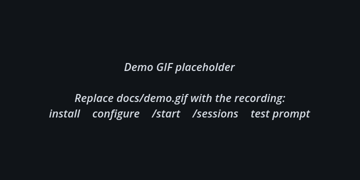

# dsh-telegram-bot

Telegram bot for [DeepSeek Harness](https://github.com/deepseek-ai/deepseek-harness), configured from the Harness Web UI.

> Found a bug or have an idea? [Open an issue](https://github.com/Boobaw/dsh-telegram-bot/issues).

The bot connects to Telegram, enforces the allowlists, and bridges DSH agent sessions to Telegram **DM topics**. The **All** topic stays global; every DSH session gets its own topic. The assistant answer is the first message and streams in place as text arrives; the current reasoning block and a rolling tool-call list update after it, then both transient messages are deleted when the answer is ready. Bot lifecycle notifications go to **All**.

## Demo

<p align="center">
  
</p>

The recording covers the first-run flow: install the plugin, save the bot token, enable Threaded mode, allowlist the user, run `/start`, open `/sessions`, and send a test prompt.

## Features

- **Settings → Telegram** page in the Web UI.
- **Bot token**, stored through the credential seam and never written into the settings file. The credential reference is configurable with `tokenRef` (default `TELEGRAM_BOT_TOKEN`).
- **Allowed users** — Telegram user ids or `@usernames`.
- **Allowed chats** — Telegram chat ids or `@channelnames`; empty means private chats only.
- **Enable bot** toggle.
- **Restart bot** button — reapplies the saved settings and restarts long polling.
- **Plugins page** — the bundle page is informational and points to Settings → Telegram. The bundle switch above it is the plugin on/off control; turning it off unmounts the runtime and aborts polling.
- **Agent bridge** — an ordinary text message in a session topic starts a DSH agent turn in that session, with assistant text streamed back.
- **DM topics** — `/sessions` in **All** is the single place for DSH sessions: choose a workspace, then create a new session in it or open an existing one. The selected session continues in its own topic. Requires **Threaded mode** in @BotFather → Bot Settings.
- **All topic** — Telegram's default topic and the management hub; lifecycle notifications are posted there.
- **Thinking and tool calls** — reasoning deltas and tool calls are mirrored into the topic, with independent **Show model thinking** / **Show tool calls** switches. Thinking is a 10-line rolling window; the tool-call message shows the last ten calls.
- **Commands** — `/start`, `/help`, `/sessions`, `/stop`, `/status`, `/current`, `/menu`, `/rename`, `/last`, `/restart`, `/id`, `/ping`.
- **Approval prompts** — when a tool asks for approval, the session topic gets a styled prompt with **Deny** and **Allow** inline buttons; the decision resolves the exact pending request.
- **Structured questions** — `ask_user_question` requests render in the session topic with option buttons, multi-select, a custom-answer flow, and plan-review approve/decline choices.
- **Session controls** — an inline 2×2 panel in each session topic: **Model** (Flash/Pro), **Effort** (off/low/high/max), **Mode** (permission preset), and **Context** (window, last request usage, and cache-hit percentage). Telegram reply keyboards are chat-wide, so the controls are a per-topic inline panel rather than a bottom keyboard.
- **Recovery** — `/last [n]` shows the latest assistant answer(s) from the bound session, useful after switching between Web and Telegram. `/rename <name>` changes the Telegram topic title; `/restart` restarts the Telegram runtime; `/menu` opens the inline session controls.
- **Language** — bot messages and the Telegram command menu default to English; a Settings selector switches them to Russian.
- **Formatting** — assistant Markdown (headings, bold, lists, code, links, tables) is converted to Telegram MarkdownV2. The same formatting is used for session previews and `/last`.
- **Command hints** — the runtime publishes the list with `setMyCommands`, so Telegram shows the commands and descriptions when the user types `/`. The descriptions follow the selected Bot language; English is the default.
- English and Russian page copy; Russian is registered as an optional language pack.

## Install

From this checkout, run in the repository root:

```sh
npx @deepseek-ai/dsh plugin --profile web add .
```

After publishing to npm:

```sh
npx @deepseek-ai/dsh plugin --profile web add dsh-telegram-bot
```

`dsh plugin add` installs the package and selects its bundle in `dsh.profile.bundles` when the package declares `dsh.bundle`. Restart `dsh web` if the running profile does not pick the new bundle up through HMR.

Then open **Settings → Telegram** (or **Plugins → Telegram Bot**) in the Web UI.

### Where it lives

DSH plugins are profile packages, not files inside the DeepSeek Harness checkout. A normal install resolves `dsh-telegram-bot` from npm into:

```text
~/.dsh/profiles/web/node_modules/dsh-telegram-bot
```

A local development install can instead link this repository into the profile. Either way, users do not need to know or copy a local checkout path: `dsh plugin --profile web add dsh-telegram-bot` is enough.

## Configure

| Field | Where it lives | Meaning |
| --- | --- | --- |
| Bot token | credential store | Token from [@BotFather](https://t.me/BotFather); write-only from the page |
| `tokenRef` | profile configuration | Credential/env name that holds the token; default `TELEGRAM_BOT_TOKEN` |
| `cwd` | profile configuration | Working directory for Telegram-created DSH sessions; default process cwd |
| `agentPreset` | profile configuration | Preset mounted for Telegram sessions when presets are available; default `standard` |
| Allowed users | profile configuration | Numeric Telegram user ids or `@usernames`; empty means nobody |
| Allowed chats | profile configuration | Numeric chat ids (groups are negative) or `@channelnames`; empty means private chats only |
| Show model thinking | profile configuration | Mirror reasoning deltas into a Thinking message |
| Show tool calls | profile configuration | Mirror tool names and arguments into the topic |
| Bot language | profile configuration | `en` (default) or `ru` for all Telegram bot messages |
| Enable bot | profile configuration | Whether the runtime polls Telegram while the profile runs |
| Restart | request field | Forces a fresh `getMe` + `getUpdates` cycle |

The token field reports only whether a token is configured. A token supplied by the process environment is reported as configured but cannot be overwritten from the page. Changing `tokenRef` points the runtime and the page at another credential; use it to run several bots from one host.

### First run

1. Create a bot with [@BotFather](https://t.me/BotFather) and save its token in **Settings → Telegram**.
2. In @BotFather open the bot's **Bot Settings → Threaded mode** and enable it. Without this, private-chat topics cannot be created.
3. Open the bot chat, tap the bot name and enable **Topics**. **All** is Telegram's default topic.
4. Send `/start` in **All**. With an empty user list the bot replies with your user id and chat id, plus the Threaded-mode reminder.
5. Add your user id to **Allowed users** and press **Save** (or **Restart bot**).
6. In **All** send `/sessions` to create a new session or pick an existing DSH session. The dialog continues in its own topic.

The runtime starts only when **Enable bot** is on, a token is configured, and the profile process is running. It logs connection and polling diagnostics with the `[telegram]` prefix. Runtime state is at `$DSH_HOME/telegram/status.json`, and the topic → session mapping is at `$DSH_HOME/telegram/state.json` (neither contains the token).

## Headless profile (no Web UI)

The bot does not need the Web server. A profile with `dsh-base` and this bundle polls Telegram on its own; the settings page simply is not available there.

```sh
mkdir -p ~/.dsh/profiles/tg
cd ~/.dsh/profiles/tg
```

`~/.dsh/profiles/tg/package.json`:

```json
{
  "name": "dsh-profile-tg",
  "private": true,
  "dependencies": { "dsh-telegram-bot": "^0.1.0" },
  "dsh": {
    "profile": {
      "bundles": ["@deepseek-ai/dsh-base", "dsh-telegram-bot"]
    }
  }
}
```

`~/.dsh/profiles/tg/cordis.patch.yml`:

```yaml
- id: telegram-bot
  name: dsh-telegram-bot
  config:
    enabled: true
    allowedUsers: ["<user-id>"]
    allowedChats: ["<chat-id>"]
```

Install and run without Web:

```sh
cd ~/.dsh/profiles/tg
npm install

# Prefer the credential store; for a headless deployment the matching
# environment variable is the supported fallback.
printf 'TELEGRAM_BOT_TOKEN=%s\n' '<token>' >> ~/.dsh/.env
chmod 600 ~/.dsh/.env

npx @deepseek-ai/dsh --profile tg
```

No browser and no port are opened. `Ctrl+C` stops the process; `$DSH_HOME/telegram/status.json` shows the runtime state. Do not put the token in `cordis.patch.yml`.

## Plugins page

The bundle detail page in **Plugins** is a short informational panel:

- it points to **Settings → Telegram** for token, access lists, language and display options;
- it lists the manual configuration files for headless setups;
- it does not duplicate the settings controls.

The bundle switch above the panel is the plugin on/off control. **Settings → Telegram → Enable bot** is a soft pause that keeps the plugin loaded but stops polling.

## Security

- Approvals requested by Telegram-owned agents are answered in the session topic with **Deny / Allow**; unanswered prompts stay pending until the turn is cancelled or `/stop` is used.
- The token is a secret: it lives in the credential store, not in `cordis.patch.yml`.
- An empty user list answers only in private chats with the setup hint. Once the list is non-empty, unauthorized users are ignored.
- Group/channel chats require an explicit **Allowed chats** entry.
- A DSH plugin runs in-process with the Host. Install only packages whose source you trust.
- Do not run two pollers with the same bot token; Telegram answers `409 Conflict` and one of them stops.

## Develop

No build step is needed: `index.js` is the Host half and `client.js` is the browser bundle in the module-loader factory format.

### Architecture

This is a transport plugin, not a tool plugin:

- `index.js` owns the Telegram runtime, topic routing and the bridge to existing DSH sessions;
- `client.js` only registers the Settings page and the Plugins-page note;
- the plugin adds **no model-facing tools**, **no system-prompt text** and no new agent capabilities;
- it consumes existing services with `ctx.get`, observes session and approval events with `ctx.on`, and owns its polling lifetime with `ctx.effect`;
- Telegram commands such as `/sessions` and `/last` are transport commands handled by the bot, not DSH tools exposed to the model.

That is why the model's toolset is unchanged after installing it: Telegram is another front door to the same DSH agent, not a second agent.

```sh
npm install
node --check client.js
node --check index.js
node -e "import('./index.js').then((m) => console.log(m.name, Object.keys(m)))"
```

Inspect the composed profile:

```sh
npx @deepseek-ai/dsh --profile web --dump-config
```

## Publish and claim the name

`dsh-telegram-bot` is an unscoped npm name. Publishing the package is what claims it; no other registry or catalog is required for DSH installation.

```sh
npm login
npm whoami
npm publish --dry-run
npm publish
```

A Git URL or tarball also works for DSH (`dsh plugin add github:you/dsh-telegram-bot`), but the npm package name is the identity used by `dsh plugin add`, Plugin Manager, and `npx`. Use the same name for the GitHub repository and add the `dsh-plugin` topic for discovery.

## Roadmap

1. File attachments and voice input.
2. Multiple chats and group/topic routing.
3. Richer tool-result summaries.

## License

MIT

## Credits

Markdown to Telegram formatting uses [telegramify-markdown](https://github.com/skoropadas/telegramify-markdown) (MIT).
