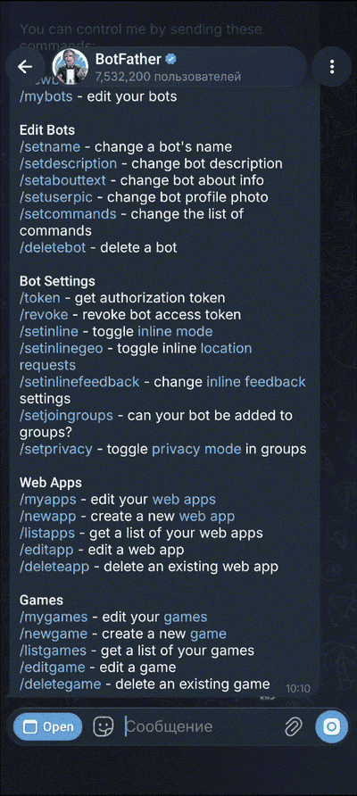

# dsh-telegram-bot

Telegram client for [DeepSeek Harness](https://github.com/deepseek-ai/deepseek-harness). It connects a DSH profile to a Telegram bot and keeps the same DSH sessions available in both interfaces.

## Demo

Video walkthrough: https://youtu.be/QEeVucfBsWk

The video covers installation, the bot token, BotFather setup, the allowlist, `/start`, `/sessions` and a test prompt.

### Enable Threaded mode

<p align="center">
  <a href="docs/threaded-mode.gif">
    
  </a>
</p>

BotFather: **Bot Settings → Threaded mode → Enable**. Click the GIF to open it full size.

## Features

- One Telegram topic per DSH session; Web and Telegram use the same session.
- `/sessions` lists workspaces and existing sessions, and can create a new session in a selected workspace.
- Assistant answers stream into the topic with Telegram Markdown formatting.
- Reasoning and tool calls are shown as temporary messages and removed after the answer. Each tool-call entry is capped at two lines.
- Inline controls for model, reasoning effort, permission mode and context usage.
- Tool approvals with **Deny** / **Allow** buttons.
- `ask_user_question` support: options, multi-select, custom answers and plan review.
- `/last`, `/rename`, `/stop`, `/restart`, `/status` and `/menu`.
- English and Russian bot messages.
- Bot token stays in the DSH credential store.

## Requirements

- DSH `0.2.1-rc.2` or newer, Node.js 22+.
- A Telegram bot token from [@BotFather](https://t.me/BotFather).
- **Threaded mode** enabled in BotFather and **Topics** enabled in the bot chat.

## Install

From this repository:

```bash
npx @deepseek-ai/dsh plugin --profile web add .
```

From npm:

```bash
npx @deepseek-ai/dsh plugin --profile web add dsh-telegram-bot@latest
```

Restart `dsh web` after installing or updating the plugin. Then open **Settings → Telegram**.

## Configure

| Field | Meaning |
| --- | --- |
| Bot token | Token from @BotFather; stored in the credential store |
| `tokenRef` | Credential/env name for the token; default `TELEGRAM_BOT_TOKEN` |
| `cwd` | Working directory for Telegram-created sessions |
| `agentPreset` | Preset mounted for Telegram sessions; default `standard` |
| Allowed users | Telegram user ids or `@usernames` |
| Allowed chats | Telegram chat ids or `@channelnames` |
| Show model thinking | Show reasoning in a temporary message |
| Show tool calls | Show tool calls in a temporary message |
| Bot language | `en` (default) or `ru` |
| Enable bot | Start or pause Telegram polling |

The token field only reports whether a token is configured. A token supplied through the environment cannot be overwritten from the page.

## First run

1. Create a bot with @BotFather and save its token in **Settings → Telegram**.
2. In @BotFather open **Bot Settings → Threaded mode** and enable it.
3. Open the bot chat, tap the bot name and enable **Topics**.
4. Send `/start` in **All**. With an empty allowlist the bot replies with your user and chat ids.
5. Add your user id to **Allowed users** and press **Save**.
6. Send `/sessions` in **All**, choose a workspace and open or create a session.
7. Send a test message in the new topic.

## Plugins page

The plugin page is informational. It points to **Settings → Telegram** and lists the manual configuration files. Use the bundle switch there to enable or disable the plugin; **Enable bot** is a soft pause that keeps the plugin loaded but stops polling.

## Headless profile

The bot can run without the Web UI:

```bash
mkdir -p ~/.dsh/profiles/tg
cd ~/.dsh/profiles/tg
```

`package.json`:

```json
{
  "name": "dsh-profile-tg",
  "private": true,
  "dependencies": { "dsh-telegram-bot": "^0.1.0" },
  "dsh": {
    "profile": {
      "bundles": ["@deepseek-ai/dsh-base", "dsh-telegram-bot"]
    }
  }
}
```

`cordis.patch.yml`:

```yaml
- id: telegram-bot
  name: dsh-telegram-bot
  config:
    enabled: true
    allowedUsers: ["<user-id>"]
    allowedChats: ["<chat-id>"]
```

Install and run:

```bash
npm install
printf 'TELEGRAM_BOT_TOKEN=%s\n' '<token>' >> ~/.dsh/.env
chmod 600 ~/.dsh/.env
npx @deepseek-ai/dsh --profile tg
```

Do not put the token in `cordis.patch.yml`.

## Security

- The bot token lives in the credential store, not in the profile patch.
- Empty **Allowed users** answers only in private chats with the setup hint.
- Group and channel chats require an entry in **Allowed chats**.
- Do not run two pollers with the same token; Telegram returns `409 Conflict`.
- A DSH plugin runs in-process with the Host. Install only source you trust.

## Development

No build step is needed.

```bash
npm install
node --check index.js
node --check client.js
```

`index.js` is the Host half: Telegram polling, topic routing and the session bridge. `client.js` registers the Settings page and the Plugins-page note. The plugin adds no model-facing tools or system-prompt text; it connects Telegram to the existing DSH agent.

## License

MIT

## Credits

Markdown to Telegram formatting uses [telegramify-markdown](https://github.com/skoropadas/telegramify-markdown) (MIT).
