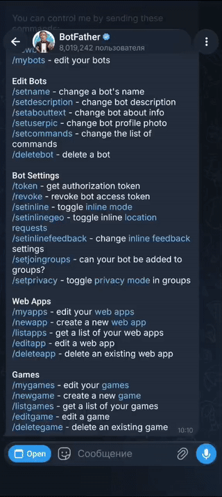

# dsh-telegram-bot

[](https://dsh-plugin.org/plugins/boobaw/dsh-telegram-bot)

> This is a maintained fork of [Boobaw/dsh-telegram-bot](https://github.com/Boobaw/dsh-telegram-bot) with `/new`, user-created topics with a workspace picker, two-way sync, sending into topics by thread id, and reply, quote and forward context. See [MAINTAINING.md](MAINTAINING.md) for what differs and how upstream changes are merged in.

Telegram client for [DeepSeek Harness](https://github.com/deepseek-ai/deepseek-harness). It connects a DSH profile to a Telegram bot and keeps the same DSH sessions available in both interfaces.

## Demo

First setup: https://youtu.be/QEeVucfBsWk

Installation, bot token, the allowlist, `/start`, `/sessions` and a test prompt.

### Enable Threaded mode

<p align="center">
  <a href="docs/threaded-mode.gif">
    
  </a>
</p>

BotFather: **Bot Settings → Threaded mode → Enable**. Leave **Disallow users to create new threads** off: you create a topic for each conversation yourself.

## Features

- One Telegram topic per DSH session; Web and Telegram use the same session.
- You create the topics. A new topic asks which workspace to use, then whether to start a new session or continue an existing one from that workspace. The message that opened the topic runs once the session is chosen.
- Topic names are yours: the bot never renames a topic after the session title. `/rename` renames it on request.
- A topic's session is titled `<topic name> · <what the conversation is about>` in DSH, for example `Chat-1 · Fix empty Telegram sessions`. The second part is DSH's own title (its title model, or the first words of the first message); until it exists the title is just the topic name. Renaming the topic changes only the first part. A title someone types for the session is left alone.
- Renaming a topic also records a short note in its session, such as `Telegram topic renamed: "Old" -> "New" (thread 123)`, so searching earlier sessions finds it under either name.
- A session the bot creates for a topic is never handed out as a blank session. DSH's **New conversation** reuses a session that has not started a turn yet; the bot therefore starts one empty turn as soon as it creates a session, and stops it before any model request. Without this, a topic session waiting for its first message could be picked up by the Web UI, and that Web chat would be mirrored into the topic.
- Deleted topics clean themselves up: when Telegram answers any call for a topic with "message thread not found", `TOPIC_ID_INVALID` or `TOPIC_DELETED`, the bot drops that topic's session binding and name and logs it. The session stays in DSH. A closed topic keeps its binding, since it can be reopened.
- `/workspace` moves the topic to another workspace: pick the workspace, then a new or existing session there. A session's working directory is fixed when it is created, so the previous session is not continued in this topic; it stays in DSH and can be bound again later as an existing session.
- Two-way sync: turns started anywhere else (Web UI, scheduled tasks, other plugins) also appear in the session's topic. The prompt is shown with a **From Web** or **Scheduled task** label, followed by the streamed answer. Messages sent from Telegram are not echoed back, and context that plugins add on their own (time, runtime notes) is not shown. A Telegram message sent while such a turn runs waits for it. Approvals and questions from those turns are answered where the turn started. Turn this off with **Show turns from other clients**.
- `/sessions` lists workspaces and existing sessions, and can create a new session in a selected workspace.
- Assistant answers stream into the topic with Telegram Markdown formatting. A message sent while the agent is working (text, photos, files, voice, forwards, replies) goes into the running turn, the way a message typed into the DSH Web UI during a turn does: the agent sees it at its next step, and the message gets a 👀 reaction (a short note where reactions are unavailable). If the turn ends just as the message arrives, DSH starts a new turn for it, and that turn's answer appears in the topic. `/clear` removes Telegram messages the agent has not picked up yet without stopping the current answer. Set `busyMessages: queue` to hold such messages until the turn ends instead.
- Files the agent shows in the Web UI also reach the topic: files it hands over with `present`, and local images in its final answer (``), are uploaded as photos (JPEG, PNG, WebP up to 10 MB) or documents (up to 50 MB) and logged like `telegram_send` messages. A file already sent to the topic earlier in the same turn (by `telegram_send` from that session, by `present`, or in the answer) is not uploaded again. This follows **Show turns from other clients** for turns started elsewhere.
- While a turn runs in a topic's session (started from Telegram or shown from another client), that topic shows "typing…". Each topic shows its own; it stops when the turn ends, fails or is stopped.
- Reasoning and tool calls are shown as temporary messages and removed after the answer. Each tool-call entry is capped at two lines.
- Inline controls for model, reasoning effort, permission mode and context usage.
- Tool approvals with **Deny** / **Allow** buttons.
- `ask_user_question` support: options, multi-select, custom answers and plan review.
- Documents and photos sent in a session topic are saved as DSH attachments and passed to the agent.
- Voice messages, audio files and round video messages are saved as files and transcribed; the agent gets the transcript and the file's path, so it can check a doubtful transcript against the recording. See [Voice messages](#voice-messages).
- Every prompt from Telegram starts with a line naming the sender, such as `[Telegram message from Ana Silva (@ana, user id 123)]`, so the agent knows who is writing when several allowed users share the bot. Prompts typed in the Web UI are not labelled.
- Replies, quotes and forwards keep their context. The agent sees the text of the replied-to message (or only the quoted part), who wrote it and when; a replied-to photo or document is attached too. A forwarded message is labelled with its origin (person, hidden account, group or channel with a message link) and original date. Several messages forwarded together become one prompt, and forwarded text never runs as a command. Long quoted text is cut at about 2,000 characters with a note.
- Replies to messages sent into a topic by a script, job, plugin or another session (see [Send to a topic](#send-to-a-topic)) also carry the full original text, when it was sent, and the sending session and job, even if the topic has moved to a new session since.
- `/new`, `/workspace`, `/last`, `/rename`, `/fork`, `/clear`, `/stop`, `/restart`, `/status` and `/menu`.
- `/new` in a session topic starts a fresh DSH session in the same workspace and binds it to the same topic; the previous session stays in DSH. In All it opens a new session topic.
- One session is bound to at most one topic: binding it to a new topic releases the old one.
- `/fork [name]` creates a DSH session fork in a new Telegram topic; without a name it uses the previous title plus the branch number.
- The session picker also has **🔀 Continue in Telegram fork**; automatic fork topics end with `(N)`.
- English and Russian bot messages.
- Bot token stays in the DSH credential store.

## Requirements

- DSH `0.2.1-rc.2` or newer, Node.js 22+.
- A Telegram bot token from [@BotFather](https://t.me/BotFather).
- **Threaded mode** enabled in BotFather, **Topics** enabled in the bot chat, and **Disallow users to create new threads** left off.

## Install

From this repository:

```bash
npx @deepseek-ai/dsh plugin --profile web add .
```

From npm:

```bash
npx @deepseek-ai/dsh plugin --profile web add dsh-telegram-bot@latest
```

The npm package is the upstream release without this fork's features; install the fork from a clone of this repository.

Restart `dsh web` after installing or updating the plugin. Then open **Settings → Telegram**.

## Configure

| Field | Meaning |
| --- | --- |
| Bot token | Token from @BotFather; stored in the credential store |
| `tokenRef` | Credential/env name for the token; default `TELEGRAM_BOT_TOKEN` |
| `cwd` | Working directory for Telegram-created sessions |
| `agentPreset` | Preset mounted for Telegram sessions; default `standard` |
| Allowed users | Telegram user ids or `@usernames` |
| Allowed chats | Telegram chat ids or `@channelnames` |
| Show model thinking | Show reasoning in a temporary message |
| Show tool calls | Show tool calls in a temporary message |
| Show turns from other clients (`mirrorTurns`) | Mirror turns started outside Telegram into the bound topic; default on |
| `busyMessages` | `steer` (default): messages sent during a turn go into it; `queue`: they wait until the turn ends |
| `transcriber` | `dsh` (default), `command` or `off`; see [Voice messages](#voice-messages) |
| `transcribeLanguage` | Language hint for DSH speech-to-text, such as `zh` or `en`; empty uses its own setting |
| `transcribeCommand` | Program and arguments for `transcriber: command` |
| `ffmpegPath` | ffmpeg used to decode recordings for DSH speech-to-text; default `ffmpeg` |
| Bot language | `en` (default) or `ru` |
| Enable bot | Start or pause Telegram polling |

The voice fields and `busyMessages` have no controls on the settings page yet; set them in the profile's `cordis.patch.yml` under the `telegram-bot` row's `config`.

The token field only reports whether a token is configured. A token supplied through the environment cannot be overwritten from the page.

## First run

1. Create a bot with @BotFather and save its token in **Settings → Telegram**.
2. In @BotFather open **Bot Settings → Threaded mode** and enable it. Leave **Disallow users to create new threads** off.
3. Open the bot chat, tap the bot name and enable **Topics**.
4. Send `/start` in **All**. With an empty allowlist the bot replies with your user and chat ids.
5. Add your user id to **Allowed users** and press **Save**.
6. Create a topic and send a message in it. Choose a workspace, then **New session** or one of the listed sessions. Your message runs in that session.

A message sent in **All** makes Telegram create a topic for it; the bot treats it like any new topic and asks for the workspace (if Telegram delivers it to All instead, the bot opens a new topic in the default workspace). Chat-wide commands are the exception: when `/start`, `/help`, `/sessions`, `/status`, `/menu`, `/id`, `/ping` or `/restart` is sent in **All** and Telegram makes a topic for it, the bot answers in **All** and deletes that topic. If the topic cannot be deleted, it leaves a short note there. `/sessions` in **All** still opens existing sessions in new topics, and commands such as `/fork` and `/last` work as before.

Topics bound by an earlier version keep their sessions after an upgrade.

## Troubleshooting topics

The bot checks `has_topics_enabled` and `allows_users_to_create_topics` on startup, writes them to `~/.dsh/telegram/status.json`, and posts a warning in the control chat when Threaded mode is off or users cannot create topics.

A correct configuration contains:

```json
"threadedMode": true,
"usersCanCreateTopics": true
```

## Send to a topic

Scripts, scheduled jobs, other plugins and agents can post into a topic by its numeric thread id (`/id` in the topic shows it). The message (text and files) appears in the topic and is also recorded in the session bound to that topic, without starting a turn: it is queued as context for that session's next turn, labelled with who sent it. A thread id the bot does not know (no binding and no known name in its chat) is an error; nothing is created. Topic names are only labels, never addresses. A known topic with no session gets a new one first, made the way `/new` makes it (the configured working directory and preset, titled after the topic), so the message is recorded; only a topic whose user is still choosing its session just shows the message, and the result says so (`note`). If no session can take the record, the message is still sent and the result carries `recordError`.

The bot also remembers each such send (`$DSH_HOME/telegram/sent-messages.json`: the last 1,000 sends from the past 180 days, text up to 20,000 characters). When someone replies to or quotes one of those messages, the agent gets the whole original text, however many Telegram messages it was split into, with its send time, job name and sending session, and a hint to open that session for more context. This works after `/new` too, when the current session never saw the message.

The bot learns a topic's name when it creates the topic, when Telegram reports a topic being created or renamed, and on `/rename`, and uses it in the labels of recorded messages and in session titles.

From a shell (no bot token needed):

```bash
dsh-telegram-send --thread 12345 "Backup finished"
some-report | dsh-telegram-send --thread 12345 --job nightly-report
dsh-telegram-send --thread 12345 --file /tmp/report.pdf "Monthly report"
```

Who sent it: `--job <name>` names the job or script, and `--from-session <id>` the DSH session. Inside a DSH session `--from-session` defaults to `$DSH_SESSION_ID`; pass `--from-session ''` to leave it out. `--from <label>` is a free-form label for senders that are neither. When the sending session is the one bound to the topic, it gets no second copy.

Long text is split into several Telegram messages. Every `--file` is sent after the text, one message per file.

The command writes the request into `$DSH_HOME/telegram/outbox/` and waits up to `--timeout` seconds (default 30) for the plugin's answer. Exit codes: `0` sent, `1` failed (the error is printed, for example an unknown thread id), `2` bad arguments, `3` still queued (the bot sends it once it runs). `--no-wait` returns right after queueing. The spool keeps requests while DSH is stopped, which is why it is a directory and not a socket; a request interrupted by a restart is sent again. The command is installed as the package's `bin`; link it onto your `PATH` if needed (`node_modules/.bin/dsh-telegram-send` in the profile).

From another Host plugin:

```js
const result = await ctx.get('telegramTopics').send({
  to: '12345',                  // the topic's thread id
  text: 'Backup **finished**',
  files: ['/tmp/report.pdf'],   // absolute paths, optional
  from: { job: 'backup', sessionId: 'session-…' }, // optional; `label` for other senders
})
// { chatId, threadId, topic, sessionId, recorded, messageIds }, plus note or recordError when it was not recorded
ctx.get('telegramTopics').topics() // [{ threadId, name, sessionId }]: known topics, name may be null
```

`send` rejects when the message was not sent. Errors that a retry cannot fix (an unknown thread id, a topic that was deleted, a missing or oversized file, nothing to send, or a failure after part of a long message already went out) carry `retryable: false`; others, such as the bot not running yet, are worth trying again. This is the shape [dsh-cron-jobs](https://github.com/soffits/dsh-cron-jobs) expects from a delivery channel, so `deliver: { via: telegramTopics, to: 12345 }` sends scheduled job results into the topic, with the job and its session named as the sender.

From an agent: the `telegram_send` tool takes `thread` (the thread id), `text` and `files` (absolute paths). The calling session is named as the sender and does not get a copy of its own message.

Text is Markdown, converted for Telegram like assistant answers. JPEG, PNG and WebP files up to 10 MB are sent as photos, other files as documents (up to 50 MB).

## Stickers

A sticker sent to the bot (also when replied to) reaches the agent as an image with a note naming its emoji, set and id, plus the meaning saved for it, if any. Static stickers are passed as they are; animated (`.tgs`) and video (`.webm`) stickers use Telegram's thumbnail, or for a video sticker without one, its first frame (ffmpeg, `ffmpegPath`). An animated sticker without a thumbnail comes as the note only.

Every received sticker is kept in a sticker library (`$DSH_HOME/telegram/stickers.json`, previews in `sticker-previews/`), keyed by Telegram's `file_unique_id`, with the `file_id` needed to send it again. The agent's `telegram_sticker` tool works with it:

| Action | Does |
|---|---|
| `find` | Search by words in the saved meaning, emoji, set name or title (`query`, `emoji`, `set`, `limit`) |
| `view` | Show one sticker (`id`) as an image |
| `note` | Save what a sticker means and when to use it (`id`, `meaning`) |
| `add_set` | Add every sticker of a set (`set`: its name or `t.me/addstickers/` link) |
| `send` | Send a sticker (`id`) into a topic (`thread`); recorded in the bound session and the send log like `telegram_send` |

## Voice messages

Voice messages, audio files and round video messages (also when replied to or forwarded) are downloaded, stored as a DSH file attachment and transcribed. The agent receives a note with the transcript, who transcribed it and the stored file's path, followed by the file itself. When transcription fails or is off, the file is still passed on and the note says why. A recording sent without text gets no "analyze the file" prompt: its transcript is the message.

- `transcriber: dsh` (default) uses DSH's own speech-to-text service, the one behind voice input in the Web UI (the `@deepseek-ai/dsh-experimental-voice-input-bundle` bundle with a provider such as the local SenseVoice model). Its default provider and language apply; `transcribeLanguage` overrides the language for Telegram. Recordings are decoded to 16 kHz mono WAV with ffmpeg, which must be installed (`ffmpegPath`).
- `transcriber: command` runs a program of your choice without a shell, for example a Whisper script or a client for a cloud service. `{file}` in `transcribeCommand` is replaced by the recording's path (it is appended when missing), and the transcript is read from standard output. Keys for a cloud service belong in that program's environment or the DSH credential store, not in the plugin config.
- `transcriber: off` passes only the file.

```yaml
- id: telegram-bot
  config:
    transcriber: command
    transcribeCommand: ["/usr/local/bin/transcribe", "--language", "auto", "{file}"]
```

## Plugins page

The plugin page is informational. It points to **Settings → Telegram** and lists the manual configuration files. Use the bundle switch there to enable or disable the plugin; **Enable bot** is a soft pause that keeps the plugin loaded but stops polling.

## Headless profile

The bot can run without the Web UI:

```bash
mkdir -p ~/.dsh/profiles/tg
cd ~/.dsh/profiles/tg
```

`package.json`:

```json
{
  "name": "dsh-profile-tg",
  "private": true,
  "dependencies": { "dsh-telegram-bot": "latest" },
  "dsh": {
    "profile": {
      "bundles": ["@deepseek-ai/dsh-base", "dsh-telegram-bot"]
    }
  }
}
```

`cordis.patch.yml`:

```yaml
- id: telegram-bot
  name: dsh-telegram-bot
  config:
    enabled: true
    allowedUsers: ["<user-id>"]
    allowedChats: ["<chat-id>"]
```

Install and run:

```bash
npm install
printf 'TELEGRAM_BOT_TOKEN=%s\n' '<token>' >> ~/.dsh/.env
chmod 600 ~/.dsh/.env
npx @deepseek-ai/dsh --profile tg
```

Do not put the token in `cordis.patch.yml`.

## Security

- The bot token lives in the credential store, not in the profile patch.
- Empty **Allowed users** answers only in private chats with the setup hint.
- Group and channel chats require an entry in **Allowed chats**.
- Do not run two pollers with the same token; Telegram returns `409 Conflict`.
- A DSH plugin runs in-process with the Host. Install only source you trust.

## Development

No build step is needed.

```bash
npm install
node --check index.js
node --check client.js
npm test
```

`src/app.js` is the Host runtime: Telegram polling, topic routing and the session bridge. `src/update-ledger.js` persists Telegram update cursors, `src/admission.js` uses the native DSH session queue. `src/formatting.js`, `src/state.js`, `src/status.js`, `src/utils.js`, `src/errors.js`, `src/config.js` and `src/constants.js` hold the supporting layers. `src/index.js` is the public entry point; root `index.js` is the loader-compatible wrapper. Root `client.js` is the loader-compatible client bundle. `src/client.js` contains the client source. `src/message-context.js` turns replies, quotes and forwards into the labelled context the agent reads. `src/topics.js` resolves send targets to thread ids and recognises deleted topics, `src/voice.js` decodes and transcribes recordings, `src/outbox.js` is the file spool behind `bin/dsh-telegram-send.js`, `src/sent-log.js` remembers sent messages for later replies, and `src/steer.js` sends messages into a running turn, and `src/stickers.js` is the sticker library. The plugin adds two model-facing tools, `telegram_send` and `telegram_sticker`, and no system-prompt text.

## License

MIT

## Credits

Markdown to Telegram formatting uses [telegramify-markdown](https://github.com/skoropadas/telegramify-markdown) (MIT).
